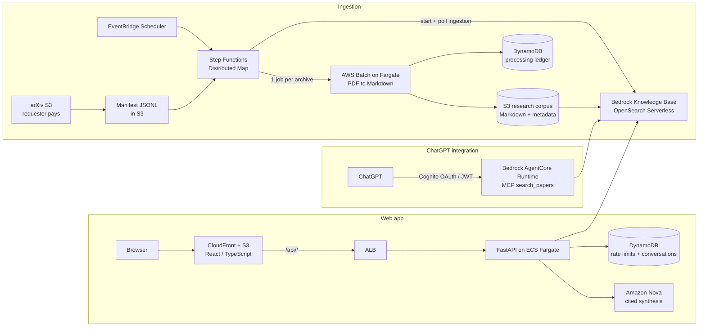

# arXiv Research Assistant

[](https://github.com/131219/arxiv-research-assistant/actions/workflows/ci.yml)

An AWS-native research assistant that turns raw arXiv PDF archives into a searchable knowledge base and answers research questions with **grounded, cited, multi-paper answers**. It is available both as a **web app** and as an **MCP server** that ChatGPT can call directly.

**Current scale:** 35+ arXiv TAR archives processed, 5,000+ papers indexed in Amazon Bedrock Knowledge Bases.

## What it does

- **Ingests arXiv at scale.** A Step Functions Distributed Map fans out one AWS Batch (Fargate) job per arXiv archive. Each job downloads the TAR, extracts every PDF, converts it to Markdown, and writes Bedrock-ready metadata sidecars to S3.
- **Indexes for semantic search.** Bedrock Knowledge Bases chunks and embeds the corpus into an OpenSearch Serverless vector index.
- **Answers with citations.** The research API retrieves relevant passages, synthesizes an answer across papers with Amazon Nova, and validates every citation against the papers that were actually retrieved.
- **Plugs into ChatGPT.** A `search_papers` MCP tool runs on Amazon Bedrock AgentCore Runtime behind Cognito OAuth, so ChatGPT can search the corpus and synthesize answers itself.
- **Supports multi-turn research chat.** Conversations persist in DynamoDB, and follow-up questions use earlier turns as retrieval context.

## Architecture



A detailed diagram of the ingestion pipeline is in [`docs/architecture-design.md`](docs/architecture-design.md).

## Tech stack

| Area | Technologies |
|------|--------------|
| Orchestration | AWS Step Functions (Distributed Map), EventBridge Scheduler, AWS Batch on Fargate, Lambda |
| Storage | Amazon S3, DynamoDB |
| AI / retrieval | Amazon Bedrock Knowledge Bases, OpenSearch Serverless, Amazon Nova, Bedrock AgentCore Runtime, Model Context Protocol (MCP) |
| Backend | Python, FastAPI, Pydantic, boto3, ECS Fargate, ALB |
| Frontend | React, TypeScript, Vite, CloudFront |
| Auth | Amazon Cognito (OAuth 2.0 / JWT) |
| Ops | CloudFormation, GitHub Actions (OIDC to AWS), Amazon ECR, CloudWatch, SNS |
| Quality | pytest, Vitest, Ruff, cfn-lint |

## Engineering highlights

**Reliable, restartable ingestion**
- Each archive is the unit of work, so a failure retries one archive, not the whole run.
- Reruns are idempotent: a DynamoDB ledger and per-archive `_SUCCESS.json` markers let completed archives be skipped, while `skip_completed=false` forces a clean reprocess.
- Every archive is validated before it is marked successful: Markdown and metadata object counts must match successful papers, and the failure rate must stay under a configurable threshold. Per-paper failures go to `failed-items.jsonl`.
- Batch and workflow failures raise EventBridge, CloudWatch, and SNS email alerts.

**Grounded answers**
- Retrieval over-fetches candidate chunks (up to 3x, capped at 20) and deduplicates by paper, so `top_k` means unique papers.
- The synthesis prompt cites stable paper IDs such as `[2606.04032]`.
- Citation validation rejects answers that cite papers that were not retrieved, or that cite nothing when evidence exists. Uncited papers are dropped from the public citation list.

**Production hardening**
- Cognito access-token verification on the website API.
- Distributed per-user rate limiting with an atomic DynamoDB conditional update (default 10 requests per 60 seconds).
- The ALB accepts traffic only from CloudFront's origin-facing IP ranges, and ECS tasks accept traffic only from the ALB.
- Stable public error contract: AWS internals are never exposed to clients.

**CI/CD**
- Every push runs Ruff, pytest, Python compile checks, CloudFormation linting, and Docker builds.
- Pushes to `main` authenticate to AWS through GitHub OIDC (no stored credentials), push immutable Git-SHA image tags to ECR, deploy the CloudFormation stacks, and verify the deployed Batch image matches the commit.

## Validation

- Single-archive acceptance test: 132 PDFs in, 132 Markdown files and 132 metadata sidecars out, zero failures, output validation passed.
- Scaled to 35+ archives and 5,000+ indexed papers.
- End-to-end flows verified against real AWS: browser to Cognito to FastAPI to Bedrock retrieval to Nova synthesis to cited answer, and ChatGPT to Cognito OAuth to AgentCore MCP to Bedrock retrieval.
- Observed retrieval cost in development: about $0.001 per query.
- 166 backend tests (pytest) and frontend tests (Vitest).

## API

| Method | Path | Purpose |
|--------|------|---------|
| GET | `/health` | Health check |
| POST | `/api/v1/research` | Single research question with cited answer |
| POST | `/api/v1/conversations` | Start a conversation |
| GET | `/api/v1/conversations/{id}` | Fetch conversation history |
| POST | `/api/v1/conversations/{id}/messages` | Ask a follow-up question |

MCP tool: `search_papers(query, top_k)` returns unique papers with passage, score, and arXiv URL.

## Project structure

```text
src/arxiv_pipeline/
  manifest/     arXiv manifest parsing into JSONL work lists
  processor/    Batch worker: download, extract, parse PDF, write Markdown
  validation/   output validation
  retrieval/    shared Bedrock KB retrieval + dedup
  synthesis/    cited multi-paper synthesis + citation validation
  api/          FastAPI service, auth, rate limiting, conversations
  mcp/          MCP server (search_papers)
  evaluation/   retrieval quality evaluation tooling
frontend/       React + TypeScript web app
infrastructure/ CloudFormation templates, Step Functions ASL, IAM policies
tests/          unit tests
docs/           architecture design, ingestion runbook, API contract
```

## Running locally

```bash
python3 -m venv .venv
source .venv/bin/activate
pip install -r requirements.txt -r requirements-api.txt
pytest -q
```

Run the API against your own Bedrock Knowledge Base:

```bash
export AWS_REGION=us-east-1
export BEDROCK_KNOWLEDGE_BASE_ID=<your-knowledge-base-id>
export BEDROCK_MODEL_ID=us.amazon.nova-2-lite-v1:0

uvicorn arxiv_pipeline.api.main:app --app-dir src --port 8000
```

Frontend:

```bash
cd frontend
cp .env.example .env   # fill in your Cognito settings
npm install
npm run dev
```

All AWS account IDs and resource identifiers in this repository are placeholders. To deploy, set the `AWS_ACCOUNT_ID` repository variable and update the parameter files under `infrastructure/cloudformation/parameters/`. CI deploy jobs only run when that variable is set.

## Roadmap

- Full monthly backfill (about 32,000 papers per month)
- Private subnets, VPC endpoints, and customer-managed KMS keys
- Formal retrieval evaluation metrics
- Staging and production environments with automated promotion
